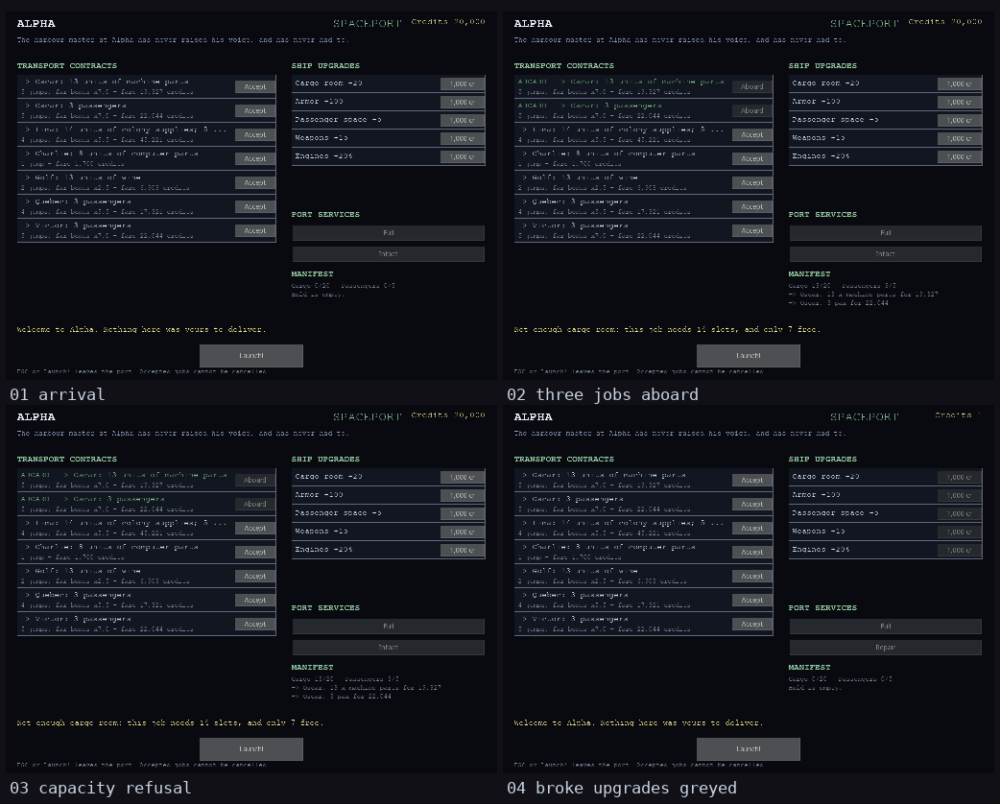
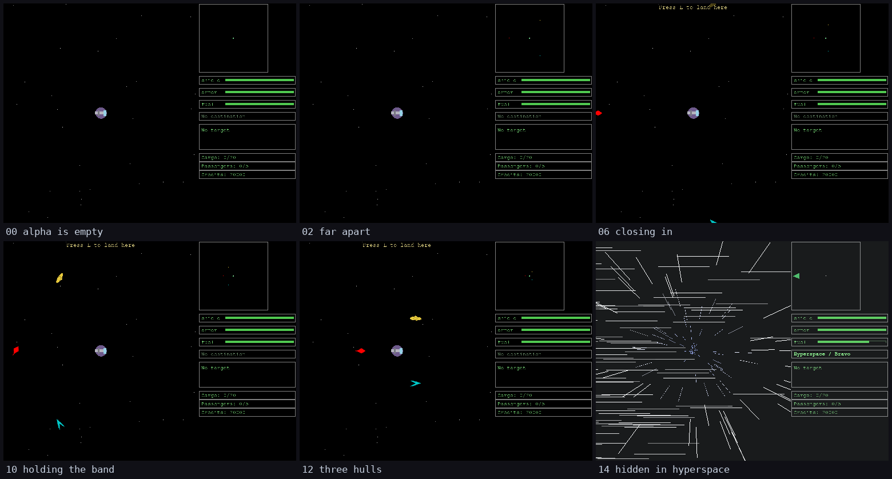
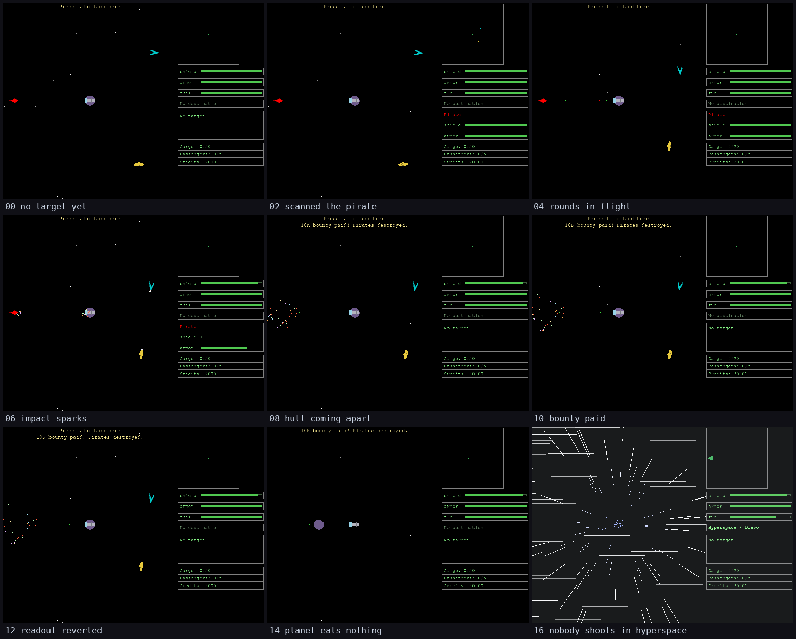

# The velocity of escape

A space exploration game with real-time navigation and strategy elements. The
player controls a small blocky cargo shuttle, explores 26 solar systems with
an Asteroids-style tactical view, carries cargo and passengers to earn credits,
and fights warring factions of hostile ships.

## Setup

1. Create a virtual environment:

   ```bash
   python -m venv venv
   ```

2. Activate it (Linux/macOS):

   ```bash
   source venv/bin/activate
   ```

   Windows (PowerShell): `. venv\Scripts\Activate.ps1`
   Windows (CMD): `venv\Scripts\activate.cmd`

3. Install the pinned dependencies:

   ```bash
   pip install -r requirements.txt
   ```

4. (Optional) Regenerate the title screen background image:

   ```bash
   python scripts/generate_title_screen.py
   ```

   `resources/title_screen.png` is generated by this script and is used as the
   title screen background (a default dark gradient is committed).

## Running

From the project root (the root must be on `sys.path`, which the shim does for
you):

```bash
python main.py
```

The game opens a non-resizable 1024x768 window and locks to a 60 FPS fixed
timestep. There is no fullscreen option.

## Controls

- `M` — toggle the System Map (full-screen modal). Click a system to set it as
  your destination, click it again to clear the selection. `ESC` (or `M`) closes
  the map and returns you to the tactical view; the simulation is paused while
  the map is open.
- `J` — jump to the selected system. Costs `tactical.jump.fuel_cost` fuel, paid
  up front, and takes `tactical.jump.frames` frames of acceleration followed by
  a short screen flash during which you arrive. You cannot steer or cancel
  mid-jump, and `M` stays closed until you land. `J` does nothing if no system
  is selected, tells you "insufficient fuel" if you cannot pay, and refuses if
  you are inside landing range of the planet.
- `L` — land at the current planet and open the spaceport (full-screen modal).
  Legal only inside `tactical.landing_range` of the planet, and only while not
  jumping; outside that range it does nothing, silently, exactly like `J` with no
  destination selected. Landing settles any cargo bound for this system (see
  "Trading" below), stops the ship, refills shields, and makes you immune while
  you sit there. The simulation underneath is paused while the spaceport is open.
- `Launch!` (or `ESC`, while the spaceport is open) — leave the planet. You get
  `tactical.launch_immunity_frames` frames (2 seconds) of immunity on the way out,
  so parking in a hostile system is survivable once.
- `T` — scan for ships in the current system. The HUD "nearest ship" readout
  locks onto the closest living hull and keeps showing it — alignment word plus
  shield and armour bars — for as long as that hull is flying, even when another
  one drifts closer. It reverts to `No target` on its own the moment the scanned
  hull is destroyed (no keypress needed), and every new system starts at
  `No target`. Press `T` again to re-lock on whoever is nearest right now.
- `ESC` — close whatever modal is open (System Map, difficulty dialog, the "Exit
  game?" confirmation). On the spaceport it is the same as clicking `Launch!`.
  Out in the tactical view it raises an **"Exit game?"** confirmation: **Keep
  playing** puts it away, **Return to title screen** abandons the run and clears
  the scene stack, so the next `New game` starts clean. It is refused while
  jumping — a ship in hyperspace has already paid for a system it is about to
  arrive in, and un-arriving is not a pause menu. QUIT (closing the window) still
  exits the game outright, anywhere.
- Arrow keys — rotate the ship (hold to keep turning, release to stop).
  `Up` applies thrust (consumes fuel); `Down` reverses course once, then stops.
- `Space` — fire the ship's projectile weapon. **Hold it**, don't tap it: the gun
  releases `player_ship.weapon_fire_rate` projectiles per second, and pulling the
  trigger while the gun is cycling does nothing at all — silently, with no message
  and no queued shot. A round leaves the muzzle at your own velocity *plus*
  `combat.projectile_speed_bonus` along your heading, so a round fired forward
  while running at 5 px/frame travels 13 px/frame and reaches its target sooner;
  fired backward, it crawls. It flies until it hits a hull or spends
  `player_ship.weapon_range`, whichever comes first. Firing is refused (silently)
  while landed, while jumping, and when the hull is a wreck.

## General usage

- Start from the title screen; choose Easy, Medium, or Hard to pick the
  difficulty (this selects one of the `config_*.json` files).
- Start a new game; the player begins in the Alpha system with
  `new_game.starting_credits` credits and an empty ship.
- Press `M` for the System Map: white circles are systems, thin grey lines are
  hyperspace lanes, the green circle is where you are now, and `[Name]` marks
  your chosen destination. Only systems you have reached - plus everything
  linked to them - are drawn at all; the rest of the graph stays in the fog of
  war, permanently revealed once you arrive.
- You can only select a system that is drawn **and** directly linked to the
  system you are standing in; the current system itself is never selectable, and
  clicking a selected system clears the selection. The HUD nav line reflects the
  choice (`No destination` becomes `Hyperspace / Bravo`).
- Jumping is how you travel: pick a neighbour on the map (`M`), press `J`, and
  sit back while the ship burns for three seconds and the screen goes white. The
  flash is not decoration — your arrival (a new sky, a new planet, a new spawn
  point well away from that planet) happens under it. Fuel comes out of your tank
  the instant the jump starts, shields refill to full on arrival for free, and the
  system you land in permanently reveals everything linked to it.
- You cannot jump from inside landing range of a planet — fly out first. And you
  cannot leave a system any other way: hitting the edge of the system stops the
  ship and shows "System boundary reached" (at most once every
  `tactical.boundary_warnings.cooldown_frames` frames). The one exception is a
  jump: once you are burning, the boundary no longer applies.
- Other ships live in the system you have just flown into. Arriving somewhere
  new rolls its traffic: Alpha is always empty (the starting system is safe), and
  everywhere else the chance rises with the system's *name* — Bravo is the
  quietest system with traffic, Zulu the busiest, whatever the map looks like.
  A fleet belongs to the visit: land, launch, and land again and the same ships
  are still out there; jump out and come back and a new lot is waiting. They are
  painted in their faction's colour — cyan Localhoster (arrow), yellow Bobber
  (saucer), red Pirate (raider) — and the same colours mark them on the minimap.
  Pirates attack everyone, including each other's allies; Localhosters and
  Bobbers are at war with each other and leave you alone until you do something
  about it. Everyone shoots now: pirate rounds are red, Bobber rounds yellow,
  Localhoster rounds cyan, and yours are green — on the hulls, on the minimap, in
  the trails of the rounds themselves, and in the sparks a hit throws. A round
  that lands on a Localhoster or a Bobber makes that faction permanently hostile,
  and a faction at war with you hunts you the way pirates already do. Nobody can
  hit what they fired themselves, and a ship never takes damage from its own
  faction's rounds, so the traffic shoots at *you* and at each other.
- Land with `L` at a planet to reach the spaceport, accept cargo/passenger
  contracts and ship upgrades, top up fuel and armour, then leave with `Launch!`
  or `ESC`.
- Reach `economy.win_credits` (1,000,000 credits) to win the game.

### Trading

The economy is the loop the rest of the game exists to serve, so it is worth
stating plainly:

1. **Enter a system.** Entering one — starting a run in Alpha, or arriving by
   jump — deals that system's market: `economy.missions_min`–`missions_max`
   transport contracts and `economy.upgrade_offers_min`–`upgrade_offers_max` ship
   upgrades. The market belongs to the *visit*, not to the spaceport screen: land,
   launch, and land again in the same system and the same contracts are still on
   the board (minus anything you have already taken). Jumping away and coming back
   is a new visit, and that does deal a new list. Offers are sized for the hull you
   had when you entered, so a cargo upgrade bought here pays off at the *next*
   port. Re-drawing the screen never re-rolls anything, at any time.
2. **Read the rows.** A contract says what it carries, where it goes, how many
   jumps that is, the far bonus if any, and the fare. The destination is never
   the system you are standing in. Fares are monotonic: on one board, more
   payload is never cheaper, and a longer lane is never cheaper for the same
   payload.
3. **Accept.** Accepting occupies cargo holds and/or passenger berths for the
   whole trip. A job never splits: if the hold cannot take all of it, the click is
   refused and the message says how much room you actually have left. Accepted
   jobs cannot be cancelled from this screen.
4. **Spend the rest of your money** while you are here — a full tank, a full hull,
   or an upgrade that permanently raises a stat.
5. **Jump the lane** (`M` to select, `J` to burn). A long lane may need a
   mid-lane fuel stop: land anywhere, buy fuel, launch, continue.
6. **Land at the destination.** Anything bound for that system is unloaded
   automatically and paid out once, and the spaceport opens with the message:
   `Unloaded 3 cargo units and 1 passenger at Bravo: +4,321 credits.` Landing
   again at the same system with the same job aboard pays nothing: a fare is
   collected exactly once.

Credits can never reach zero by buying something: a purchase that would leave
exactly 0 credits is refused with a message, the same way a jump that would leave
exactly 0 fuel is refused. The HUD shows the balance, cargo used, and passengers
used at all times (the spaceport repeats them, since the HUD is covered there).

### Ship upgrades

Each stat is bought one level at a time, and the price of level *n* is
`upgrade_base_cost * upgrade_cost_multiplier ** (n - 1)` — exponential, so level 5
on hard costs 81 times what level 1 did. A stat at `upgrade_max_level` is simply
never offered again, and the button reads `Done` once installed. Upgrades are
permanent for the run (a new game resets them).

### Combat

Shooting is the reason the factions exist, so the rules are worth stating in
order:

- **Damage eats shields first, then armour.** An NPC hull is destroyed when its
  armour reaches 0; overkill is not clamped, so a round that lands for more than
  the hull can absorb is simply over. The player's hull obeys the same order, and
  it is the *same function* (`src/model/stats.py::apply_damage_order`) — two
  implementations of "which bar goes down first" is how a game ends up with the
  player and the NPCs playing different games.
- **A hit is a diplomatic incident.** Any player round that lands on a Localhoster
  or a Bobber — even one its shields soaked — makes that faction hostile for the
  rest of the run. Pirates are already hostile, so shooting them changes nothing
  about who is shooting at you. A stray round from a faction you are on peaceful
  terms with damages you but does *not* start a war: collisions are not acts of
  war, which is why the round's colour is the warning.
- **Killing pays.** A hull you finished is worth `combat.pirate_bounty`,
  `combat.localhoster_bounty` or `combat.bobber_bounty`, and the banner says so
  (`10K bounty paid! Pirates destroyed.` / `Bobbers send their thanks! 5K bounty
  paid.`). A pirate bounty comes from the game; a war-side bounty comes from the
  faction that hates the hull you just killed — and if *that* payer already hates
  you, the bounty is simply not offered. Kill a pirate while nobody else's gun
  lands the final blow and you get nothing: only your own rounds pay.
- **Immunity is immunity.** Landed, jumping, or inside
  `tactical.launch_immunity_frames` of launching, rounds pass straight through
  you (and keep flying — they are not consumed by your invulnerability). The
  system's planet is likewise not a target: rounds fly through the disc.
- **Dying ends the run.** Armour at 0 stops the ship, locks the controls, and puts
  the end screen up over everything. See "Ending a run" below for the other three
  ways this game can finish.

### Ending a run: the four ways this game finishes

A run ends exactly once, and then the end screen takes over the whole window —
whatever was underneath it (a dogfight, a spaceport counter) stops simulating
without anything having to ask it to. Which ending you get depends on *where* you
are when the condition becomes true:

| Ending | Headline | Fires when |
| --- | --- | --- |
| Ship lost | `Ship lost with all hands!` | armour reaches 0 — anywhere, at any moment |
| Stranded | `Stranded! Lost in space!` | the tank is empty and no spaceport is within `tactical.landing_range` |
| Bankrupt | `Bankrupt!` | at a spaceport: the tank cannot pay for a jump, and a full tank is unaffordable |
| Victory | `You're a millionaire! You win!` | the balance reaches `economy.win_credits` — checked at a spaceport |

The two credit endings are judged **at a spaceport only**, and the ordering is
deliberate:

- **Unloading comes first.** Arrive with 1,900 credits and 5,000 credits of cargo
  bound for this system and you are not bankrupt: the fare is in your pocket before
  the question is asked. The question is then re-asked after *every* purchase in
  the port, because buying an upgrade is the transaction that most often makes the
  next tank of fuel unaffordable — and a shop that let you walk out with no fuel,
  no credits, and no way to jump is a softlock with a service counter.
- **Winning outranks going broke.** A fare that carries you past `win_credits`
  while leaving you unable to afford fuel is a win, not a bankruptcy.
- **Victory never interrupts a flight.** A bounty that crosses the target in
  mid-air is banked silently; you find out at the next spaceport you use.

Two rules are what make "Stranded!" mean something, and both are worth knowing
before you blame the fuel gauge:

- **A dry tank buys no thrust.** The moment `fuel` reaches 0, `Up` stops doing
  anything. Velocity carries on (Newton does), so a hull that spent its last unit
  of fuel a little short of the planet can still coast in — it just cannot climb
  back out. Without this rule "Stranded!" would be a suggestion: fuel 0 would keep
  accelerating you home for free.
- **`J` at exactly the jump cost is fatal, and it says so.** The jump rules refuse
  a jump they cannot pay for *and survive* (see "Jumping and the tactical
  envelope"), and that refusal is reported as `Stranded! Lost in space!` rather
  than a silent beep. Keep a margin above `tactical.jump.fuel_cost`.

The end screen prints the headline, one line on *why* it fired, and the run's
numbers: final balance (against the target it was chasing), the system the run
ended in, systems discovered, jumps made, contracts delivered, credits earned,
credits spent, hulls destroyed, and time in the saddle. Those numbers are counted
as they happen, not reconstructed afterwards, which is why "contracts delivered"
can survive the cargo itself being unloaded.

`Return to title screen` (or `ESC`) tears the whole run down rather than putting
it away: a second `New game` starts with Alpha–Delta on the charts, the configured
starting balance, a full tank, an empty hold, and nobody who remembers the first
run. That is tested on purpose — see `tests/test_stage13.py`'s
`test_secondNewGame_afterAFullRun_shouldStartCleanInEveryObservableWay`.

### Audio: what makes a noise

Every effect is synthesised at run time with the stdlib `array` module and handed
to `pygame.mixer.Sound(buffer=...)`: there are no audio files in `resources`, and
no numpy. Seven effects exist, and each is tied to exactly one event:

| Effect (config key) | Plays when |
| --- | --- |
| `confirm_beep` | a selection **succeeded** in the map view or the spaceport view |
| `weapon_fire` | a round leaves any gun — **including a ship outside the 683px view** |
| `ship_impact` | a round lands on a hull (the player's included) and it survives |
| `ship_destruction` | a hull comes apart, whoever's gun finished it |
| `scan_klaxon` | you press `T` and the readout locks onto a faction that is hostile to you |
| `jump_spinup` | the hyperspace burn starts |
| `jump_thunderclap` | the arrival frame — the same frame the screen goes white |

What is deliberately *not* a sound: the readout reverting to `No target`, a jump
that was refused, a spaceport transaction that failed, a scan that found a neutral
(or nothing), and the player's own death. The last one is worth spelling out: the
round that killed you already played the big boom, and stacking an identical
buffer on the same frame is one louder boom rather than two events.

**Audio can never crash the game.** If the mixer cannot initialise — no audio
device, a container without one, a driver that reports a sample format these
generators cannot produce — every effect becomes silent and the game carries on.
If you want to know *why* it went silent, ask for the swallowed errors:

```bash
COLLABBOB_AUDIO_DEBUG=1 python main.py     # swallowed audio failures -> stderr
```

Levels come from the `audio` section (see
[Sound levels](#sound-levels-audio)). There is no positional audio yet: a ship
firing 900px off the starboard bow is heard dead centre, at the same level as one
point-blank ahead. That is a mixer choice (`Sound.set_volume(left, right)` plus
the camera transform the tactical view already owns), not a rule of the game.

## Configuration

The game reads `config_easy.json`, `config_medium.json`, and
`config_hard.json` from the project root. They are parsed and validated once
at startup; any missing, unreadable, or invalid config file (including missing
or unrecognized keys) causes the game to exit immediately with an error
printed to stderr. All three files must contain identical keys; the easy,
medium, and hard files are tuned for easy, balanced, and difficult play
(easy: generous economy and better starting ship stats with lighter fuel
usage; hard: smaller fares, faster fuel burn, more expensive upgrades).

The `map` section controls the shape of the world graph:

```json
"map": {
  "system_count": 26,
  "connections_min": 1,
  "connections_max": 3,
  "alpha_connections": ["Bravo", "Charlie", "Delta"]
}
```

- `system_count` — how many of the NATO-named systems exist (2...26; the name
  roster itself lives in code, `src/map_systems/graph.py::NATO_SYSTEMS`).
- `connections_min` / `connections_max` — the degree bounds every system must
  satisfy. With `connections_min: 1` the graph is a bare spanning tree, so only
  one route leads back to Alpha; raising it to 2 forces extra lanes (and makes
  route redundancy possible).
- `alpha_connections` — the systems Alpha is linked to. These are its *only*
  links, pinning its degree at exactly `len(alpha_connections)`.

Impossible combinations (e.g. `connections_min` above `connections_max`, or
`system_count: 27`) are rejected at startup rather than crashing the game when
you start a new game. The RNG seed in `rng.seed` doubles as the world seed: set
it to a number to get the same 26-system map every run.

### Jumping and the tactical envelope

The `tactical.jump` block controls the trip and where you turn up:

```json
"jump": {
  "fuel_cost": 250,
  "frames": 180,
  "acceleration": 1.2,
  "transition_frames": 45,
  "spawn_distance": [400, 850]
},
"boundary_warnings": {"message_frames": 120, "cooldown_frames": 300}
```

- `fuel_cost` — charged in full the moment the jump starts, never refunded.
- `frames` — how long the ship accelerates, in fixed timesteps (180 = 3 seconds).
  The burn ignores `player_ship.top_speed`; that is what makes a jump feel like a
  jump.
- `acceleration` — px/frame² during the burn. Terminal speed is roughly
  `acceleration * frames`.
- `transition_frames` — the white-out. The world swap happens on the frame the
  flash goes fully opaque, so the arrival is never visible. Raise it for a more
  theatrical arrival, lower it for a snappier one; 36 (easy) to 60 (hard).
- `spawn_distance` — the `[min, max]` band, in pixels from the planet, at which
  you arrive. The bearing is random.

`tactical.boundary_warnings` sets how long the "System boundary reached" banner
stays up (`message_frames`) and how long before it may appear again
(`cooldown_frames`, 300 = five seconds).

Two of these are cross-checked against the rest of `tactical` at startup, because
a band the game could not honour would otherwise misplace the player mid-jump:
`tactical.jump.spawn_distance[0]` must exceed `tactical.landing_range` (you are
supposed to fly to the planet), and `spawn_distance[1]` must stay within half of
`tactical.system_pixel_size` (you are not supposed to arrive outside the system
you just paid to reach).

### Traffic and factions (`npc`)

The `npc` block decides who is orbiting a system when you arrive:

```json
"npc": {
  "spawn_chance_near": 0.1,
  "spawn_chance_far": 0.7,
  "ships_min": 1,
  "ships_max": 4,
  "stat_multiple": 4.0,
  "stat_variance": 0.5,
  "aim_jitter_degrees": 4.0,
  "engage_range_fraction": 0.75,
  "min_distance_from_player": 350
}
```

- `spawn_chance_near` / `spawn_chance_far` — the chance that a visit spawns any
  traffic at all, at the first system after Alpha and at the last one in play.
  The chance ramps linearly between those two across the systems **in play**, by
  name index, so shrinking `map.system_count` moves the top of the ramp instead
  of stranding it past the end of the roster. Alpha is always 0%: no value in
  this file can make the starting system dangerous.
- `ships_min` / `ships_max` — how many ships a successful roll produces (the spec's
  "1 to 4"). Rolled once per visit, not once per ship: a system either has traffic
  or it does not.
- `stat_multiple` / `stat_variance` — an NPC's shields, armour and weapon power
  are the player's **starting** values times the multiple, plus or minus the
  variance. With the medium defaults (50 shields / 100 armour / power 10, 4.0 and
  0.5) a hull arrives with 100–300 shields, 200–600 armour and 20–60 damage. The
  galaxy does not rescale when you upgrade: a pirate is always measured against
  the ship you *started* with.
- `weapon_fire_rate` and `weapon_range` are not in this block — an NPC's gun is
  the player's starting gun, straight from `player_ship`, per the spec.
- `aim_jitter_degrees` — how badly they shoot. The shot leaves along the true
  bearing to the target, deflected by up to this many degrees. The hull itself
  still points at you, so the aim is honest and the accuracy is not.
- `engage_range_fraction` — how close a ship comes before it stops closing, as a
  fraction of its own gun range. It must be in `(0, 1]`: above 1 a fleet would
  stop outside its own guns and never fire at all. (0.75 is 900px on medium, and
  see the visibility gotcha below.)
- `min_distance_from_player` — spawn positions are re-rolled until they are at
  least this many pixels from you, so an arrival is not instantly down the barrel
  of someone who can see you from across the system.

The shipped values, and what each difficulty is really doing:

| key | Easy | Medium | Hard |
| --- | --- | --- | --- |
| `spawn_chance_near` → `spawn_chance_far` | 0.05 → 0.45 | 0.10 → 0.70 | 0.25 → 0.95 |
| `ships_min` / `ships_max` | 1 / 3 | 1 / 4 | 1 / 4 |
| `stat_multiple` ± `stat_variance` | 3.0 ± 0.4 | 4.0 ± 0.5 | 5.0 ± 0.5 |
| `aim_jitter_degrees` | 6.0 | 4.0 | 2.0 |
| `engage_range_fraction` | 0.65 | 0.75 | 0.85 |
| `min_distance_from_player` | 400 | 350 | 300 |

Because an NPC's gun *is* the player's starting gun, an NPC's damage per second
is always `stat_multiple` times what the player started with — that ratio is the
same fight everywhere. The difficulty comes from how often traffic appears, how
many ships, how tough the hulls are, and how tightly and accurately they crowd
in, not from their rate of fire.

Two gotchas for anyone retuning this block:

- **The band has to fit inside the system.** `engage_range_fraction ×
  player_ship.weapon_range` is the radius a ship parks at. Make it bigger than
  half of `tactical.system_pixel_size` and there is not enough universe: the whole
  fleet presses itself against the system boundary instead of holding its band.
  Nothing crashes, which is why this is checked by a test
  (`testshippedConfigs_engagementBandsShouldFitInsideTheirOwnSystems`) rather than
  being fatal at startup.
- **The band is wider than the view.** The game view is 683x768 and a medium-band
  ship sits 900px out, so a fleet holding its band is visible on the minimap and
  not on the screen. Stage 11 shipped with the traffic shooting from out there
  rather than adding off-screen contact indicators: an incoming round appears at
  the edge of the view and crosses it, and the direction it comes from is the
  warning. Shrinking `engage_range_fraction` (or `player_ship.weapon_range`) is
  the blunt version of bringing a fight on screen; `scripts/capture_stage11_combat.py`
  narrows the range to 420px precisely so the whole engagement fits in one picture.

### Combat: rounds, sparks, and bounties (`combat`)

The `combat` block tunes the fight on top of one hull's stat sheet. A gun's own
numbers (`weapon_power`, `weapon_fire_rate`, `weapon_range`) live in `player_ship`,
and an NPC hull copies them; this block is what the *projectiles* and the payouts
need:

```json
"combat": {
  "projectile_speed_bonus": 8,
  "projectile_diameter": 3,
  "pirate_bounty": 10000,
  "bobber_bounty": 5000,
  "localhoster_bounty": 5000
}
```

| Key | Easy | Medium | Hard | What it does |
| --- | --- | --- | --- | --- |
| `projectile_speed_bonus` | 10 | 8 | 6 | px/frame added along the shooter's heading, *on top of* the shooter's own velocity |
| `projectile_diameter` | 3 | 3 | 3 | how wide a round is painted, in pixels |
| `pirate_bounty` | 15000 | 10000 | 12000 | credits for a pirate hull the player finished |
| `bobber_bounty` | 8000 | 5000 | 6000 | credits for a Bobber hull the player finished |
| `localhoster_bounty` | 8000 | 5000 | 6000 | credits for a Localhoster hull the player finished |

Four things worth knowing before retuning it:

- **`projectile_diameter` is a diameter.** The spec fixes a round at 3px across and
  pygame draws circles by radius, so the conversion (`diameter // 2`, floored at 1
  so a round is never a single invisible pixel) happens in exactly one place:
  `CombatRules.projectile_radius`. The key used to be named `projectile_radius`
  while holding a diameter; that name is now rejected, along with every other
  unknown key, at startup.
- **The bounty keys are named for the victim, not the payer.** Killing a Bobber is
  worth `bobber_bounty`, and the Localhosters are the ones who thank you for it.
  Pricing the two war-sides separately therefore needs no second table.
- **A speed bonus below a ship's top speed makes a round dodgeable.** A round's
  real velocity is the shooter's velocity plus this bonus along the heading: at the
  shipped medium values a forward round leaves at 5 + 8 = 13 px/frame and one
  fired while backing away at 8 - 5 = 3 px/frame. `player_ship.weapon_range` is the
  round's *travel budget*, not a radius, so a backward shot still flies its full
  1200px — it just takes 400 frames to do it.
- **Zero is a real value.** `"pirate_bounty": 0` means nobody pays and no banner is
  printed (rather than a banner reading `0K bounty paid!`). A negative bounty, a
  diameter below 1, or a negative speed bonus is a fatal config error at startup.

### Economy: contracts, upgrades, and port services

The `economy` block prices everything the spaceport sells:

```json
"economy": {
  "missions_min": 4,
  "missions_max": 8,
  "cargo_types": ["iron ore", "wine", "textiles", "computer parts",
                  "colony supplies", "machine parts"],
  "cargo_fare_per_unit": [150, 400],
  "passenger_fare_each": [800, 2000],
  "far_destination_bonus": 1.5,
  "upgrade_offers_min": 2,
  "upgrade_offers_max": 5,
  "upgrade_base_cost": 1000,
  "upgrade_cost_multiplier": 2,
  "upgrade_max_level": 5,
  "fuel_cost_per_unit": 2,
  "repair_cost_per_point": 4,
  "win_credits": 1000000
}
```

- `missions_min` / `missions_max` — how many contracts a port offers per visit.
- `cargo_fare_per_unit` / `passenger_fare_each` — `[min, max]` ranges. **One**
  cargo rate and **one** passenger rate are rolled per port visit and shared by
  every contract on that board, so the offers are comparable against each other.
  (Rolling a fresh rate per contract is how a board ends up pricing 7 units
  cheaper than 4.)
- `far_destination_bonus` — the fare multiplier for distance: a 1-jump trip pays
  `1.0x`, and every extra hop adds this much. So `1.5` and a 3-jump lane pays
  `1 + 2*1.5 = 4.0x`. The hop count is measured on the world graph, not on the
  player's charts, so an unexplored destination still gets a fair fare.
- `upgrade_*` — see "Ship upgrades" above. The magnitudes those upgrades buy are
  separate: `upgrade_steps` (flat points for shields/armor/fuel/cargo/passengers,
  `weapon_damage` points, and a percent for `engine_percent`, which lifts
  acceleration, top speed, and turn rate together).
- `fuel_cost_per_unit` / `repair_cost_per_point` — the port service rates. The
  buttons fill the tank and the hull; a full tank or an intact hull shows `Full` /
  `Intact` and cannot be clicked.
- `win_credits` — the victory balance. Crossing it does not end the run where it
  happens; the win is announced at the next spaceport you use (see "Ending a
  run"). Set it somewhere a determined trader can reach: at the shipped rates, a
  full hold at the top of the fare range with a far-hop bonus pays tens of
  thousands per contract, so a million is a few dozen good contracts.

`new_game.starting_credits` is the balance a new run begins with (30,000 easy,
20,000 medium and hard), and `tactical.launch_immunity_frames` is the grace period
after leaving a planet.

Every one of these is validated at startup, in addition to the "unknown or
missing key is fatal" rule: a fare range whose minimum exceeds its maximum, an
upgrade multiplier below 1.0 (which would make upgrades cheaper as they get
bigger), an `upgrade_max_level` under 1, a `cargo_room`/`passenger_space` too
small to hold a single job (which would make every contract unacceptable), or a
negative launch grace period all stop the game at launch with a message naming the
key. Raising `economy.missions_max` above 10 is allowed and produces a truncated
board with an honest "...and N more this port cannot show" note — the spaceport's
row grid is a fixed 10 contracts, 7 upgrades, and 4 manifest lines.

### Sound levels (`audio`)

Loudness is configuration; the *waveform* is not. Every generated buffer is built
at a fixed reference peak and the numbers below are applied by the mixer
(`Sound.set_volume`), which is what makes `ship_impact: 0.4` mean the same
loudness for an explosion as for a beep — the generators own timbre, the config
owns level, and neither can drift into the other's job.

```json
"audio": {
  "master_volume": 0.8,
  "confirm_beep": 0.25,
  "weapon_fire": 0.3,
  "ship_impact": 0.35,
  "ship_destruction": 0.5,
  "scan_klaxon": 0.4,
  "jump_spinup": 0.32,
  "jump_thunderclap": 0.55
}
```

Every value is a number in `[0, 1]`, and `master_volume` multiplies the rest (a
master of 0 silences the game without touching a single effect level). `0` for an
individual effect silences just that effect. All three difficulty files carry
identical numbers **on purpose**: difficulty changes the galaxy, not the mixer,
and a hard-mode player should not hear different explosions.

Validation runs at startup like every other section. An unknown key
(`"explosion": 0.5`), a value outside `[0, 1]`, a `NaN`/`Infinity`, or a JSON
`true`/`false` where a level belongs (pydantic would cheerfully turn `true` into
full-scale gunfire) all stop the game with a message naming the key and the legal
choices.

Gotchas:

- **The levels belong to a run.** The title screen and the difficulty dialog
  cannot know which config you are about to pick, so they beep at the code
  defaults — which are the same numbers the shipped files carry, so nothing
  sounds different until you say so. A run's levels are handed to the mixer when
  its `GameScene` is built, and a second game re-levels it. A future settings
  screen needs exactly one call: `AudioSystem.apply_levels(AudioLevels.from_config(...))`.
- **SDL quantises volume to 1/128**, so `0.3` plays at 0.296875. `AudioSystem`
  reports what the mixer actually applied (`loaded_volumes()`), which is why the
  tests compare volumes with a tolerance instead of exactly.
- **Silence is free.** With every level at 0, no buffer is generated at all: no
  115k-sample jump sweep, no mixer voice, nothing.
- **Turning a level up does not make an effect *bigger***, only louder. "Make the
  wreck sound bigger than a hit" is a waveform question — decay, rumble pitch,
  debris hiss, and a second crack — and those parameters live in `src/audio_buffers.py`.
- **Effect *lengths* are code constants** (`_SHIP_IMPACT_MS`, `_SCAN_KLAXON_MS`,
  …), not config keys. They are tuned against the frame rate — the destruction
  boom runs 0.9s because Stage 11's biggest particle burst lasts about that long
  — and a config that could shorten them independently would let a player
  configure a boom shorter than the sparks it accompanies.

### Spaceport flavour (`resources/lore.txt`)

Each system gets one lore line, shown under its name when you land. The pool is a
plain text file, one entry per line, `#` for comments:

```
# A harbour master who has never raised his voice.
The harbour master at (System) has never raised his voice, and has never had to.
(System): the lane out here is patrolled by nobody, which is its own kind of law.
```

`(System)` is replaced with the system's name (the `{System}`/`{system}` spellings
work too); an untagged line is used verbatim. Lines are wrapped, not clipped, so
long ones stay readable. Entries are drawn from a **separate RNG stream** from the
world graph and the gameplay simulation, so adding a lore line cannot move a ship
or reroll a contract board. The file is loaded at new game, and a missing or empty
`resources/lore.txt` is a startup error rather than a silently flavourless game.

### Seeing the spaceport

One screen, four states (`stage9_spaceport.png`): a fresh board; three contracts
aboard (the manifest explains the hold); a capacity refusal, whose message names
the room you actually have; and a player with 1 credit, where every upgrade price
is greyed out because the model, not the caption, decides what is affordable.



```bash
python scripts/capture_spaceport.py --sheet stage9_spaceport.png  # one sheet
python scripts/capture_spaceport.py spaceport_frames             # individual frames
```

Deterministic: one seed fixes the world, the contract board, and the upgrade
offers, so a layout tweak can be diffed as pictures.

### Seeing the jump

The whole effect in one picture (`stage8_jump_sequence.png`), left to right, top
to bottom:


Stars stretch into streaks as the burn builds, the streaks become a tunnel racing
out of a vanishing point, the screen whites out (that white-out is what hides the
world swap — note the new sky and the reset HUD under the fading frames), and the
ship is uncovered by the fade rather than popped in at the end.

To regenerate those frames, or to grab frames of your own tweaks:

```bash
python scripts/capture_jump_frames.py --sheet stage8_jump_sequence.png  # one sheet
python scripts/capture_jump_frames.py jump_frames                       # individual frames
```

The script is deterministic: one `rng.seed` fixes the world graph, the gameplay
stream (starfield, arrival bearing) is a separate generator seeded from it, and
neither is touched by wall-clock time. So the same command always reproduces the
same pictures byte for byte — handy when a tweak to `acceleration` or
`transition_frames` needs comparing side by side.

### Seeing the traffic

Three hull designs and a steering law are hard to review in a diff, so one sheet
(`stage10_npc_fleet.png`) carries the whole story:



Left to right, top to bottom: Alpha with nothing in it (always empty, whatever the
config says); a freshly jumped-into system with a fleet that exists but is too far
away to see — the minimap is where the traffic lives at range; a pirate entering
the view from the left edge (and being clipped at the edge, not painted over the
HUD); the same fleet settled onto its engagement band, each ship exactly at
`engage_range_fraction` of its gun range; the three silhouettes up close (yellow
Bobber saucer, red Pirate raider, cyan Localhoster arrow); and hyperspace, where
the ships are hidden for the same reason the player is.

```bash
python scripts/capture_npc_fleet.py --sheet stage10_npc_fleet.png  # one sheet
python scripts/capture_npc_fleet.py npc_frames                    # individual frames
```

The script hand-places one ship per faction and pins both RNG streams, so the
same command reproduces the same pictures byte for byte. It also narrows
`player_ship.weapon_range` to 400 so the whole engagement fits inside the 683px
view — on the shipped tuning the band is 900px and the fleet is only ever visible
on the minimap.

### Seeing the fight

Nine tiles (`stage11_combat.png`), one system visit, one fight:



Left to right, top to bottom: a fresh system whose readout says `No target` even
though a pirate is sitting in view; `T` pressed, and the readout now carries the
red word `Pirate` plus that hull's shield and armour bars in the same style as the
player's own; the player's green rounds away from the ship and the traffic's
 coloured ones toward it; sparks where a round first entered the pirate's hitbox
(tinted with the firer's colour, sprayed at the entry point rather than at the
hull's centre); the same hull gone, with a strictly bigger burst; the banner that
is the only place a payout is ever stated, and the readout already back to
`No target` because the scanned hull is what died; an empty system with one round
flying straight through the planet's disc; and hyperspace, where the rounds in
flight were cleared at the gate and nobody fires while the screen is white.

```bash
python scripts/capture_stage11_combat.py --sheet stage11_combat.png  # one sheet
python scripts/capture_stage11_combat.py combat_frames               # individual frames
```

The fleet is hand-placed and both RNG streams are pinned, so the sheet is
reproducible. The script also *props the player's hull up* — but on the live stat
block, never in the config, because an NPC hull is rolled from the player's
**starting** stats and a 1000-armour pirate would turn the capture into a standoff.
The parked hulls run 50/100 defences, 12 damage, one round a second; the player's
gun runs 75 damage at three a second, which is what makes the fight end inside
nine tiles rather than at frame 4000.

### Hearing the buffers

A screenshot cannot prove that an explosion sounds bigger than a hit, so this
stage dumps the buffers instead. `scripts/render_audio_buffers.py` writes one
16-bit PCM WAV per effect and prints an amplitude profile for each — time runs
downwards, one row per slice:

```bash
python scripts/render_audio_buffers.py                          # -> audio_wav/*.wav
python scripts/render_audio_buffers.py --out /tmp/noise --raw   # skip the config levels
python scripts/render_audio_buffers.py --rate 8000 --config config_hard.json
python scripts/render_audio_buffers.py --profile-width 20       # longer profiles
python scripts/render_audio_buffers.py --profile-width 0        # the table only
```

The script imports no pygame at all — synthesis lives in `src/audio_buffers.py`,
which is stdlib-only by design and by test — so it runs in a CI container with no
audio device, and so do the buffer-generation tests.

The two combat booms, as the script prints them (`--profile-width 20`, first 12 of
20 rows each), are the whole design argument: the hit is over in 280ms and decays
monotonically, while the wreck runs 900ms, bumps back up for a second crack six
rows in, and keeps a rumble tail alive two-thirds of the way through.

```
effect             ms  samples   peak     rms  level
ship_impact       280    12348  31128    5379  0.280
|#########...........|  45.1%     <- the crack
|#######.............|  35.3%
|######..............|  30.2%
|#####...............|  24.4%
|####................|  18.9%
|###.................|  17.2%
|###.................|  13.6%
|##..................|  10.7%
|##..................|   9.6%
|#...................|   7.4%
|#...................|   5.7%
|#...................|   5.0%

ship_destruction  900    39690  31128    7164  0.400
|########............|  41.9%     <- the crack
|########............|  38.3%
|######..............|  32.1%
|######..............|  29.9%
|######..............|  29.6%
|#######.............|  36.6%     <- the second hit: fuel, after the structure
|######..............|  31.9%
|#####...............|  26.1%
|#####...............|  23.1%
|####................|  17.6%
|###.................|  16.0%
|###.................|  12.6%
```

The generated WAVs are not committed. They are reproducible byte-for-byte from the
fixed seeds inside `src/audio_buffers.py`, which is the same property that makes them
testable: a sound that changed between launches could not be pinned by an
assertion, and would mean the game sounds subtly different every time you run it.

## Tests

Run the headless test suite (it runs under the dummy SDL drivers, no display
or audio required):

```bash
pytest
```

Audio is testable headlessly because the dummy SDL audio driver hands back a real
mixer (44100Hz, signed 16-bit, mono), so the mixer-level tests assert real
`set_volume` round-trips; the paths where the mixer *fails* are faked with an
`AudioSystem` stand-in or a broken `pygame.mixer.init`. The waveform tests are pure
arithmetic — see `src/audio_buffers.py`.
