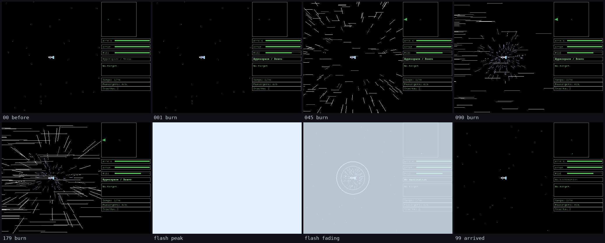

# The velocity of escape

A space exploration game with real-time navigation and strategy elements. The
player controls a small blocky cargo shuttle, explores 26 solar systems with
an Asteroids-style tactical view, carries cargo and passengers to earn credits,
and fights warring factions of hostile ships.

## Setup

1. Create a virtual environment:

   ```bash
   python -m venv venv
   ```

2. Activate it (Linux/macOS):

   ```bash
   source venv/bin/activate
   ```

   Windows (PowerShell): `. venv\Scripts\Activate.ps1`
   Windows (CMD): `venv\Scripts\activate.cmd`

3. Install the pinned dependencies:

   ```bash
   pip install -r requirements.txt
   ```

4. (Optional) Regenerate the title screen background image:

   ```bash
   python scripts/generate_title_screen.py
   ```

   `resources/title_screen.png` is generated by this script and is used as the
   title screen background (a default dark gradient is committed).

## Running

From the project root (the root must be on `sys.path`, which the shim does for
you):

```bash
python main.py
```

The game opens a non-resizable 1024x768 window and locks to a 60 FPS fixed
timestep. There is no fullscreen option.

## Controls

- `M` — toggle the System Map (full-screen modal). Click a system to set it as
  your destination, click it again to clear the selection. `ESC` (or `M`) closes
  the map and returns you to the tactical view; the simulation is paused while
  the map is open.
- `J` — jump to the selected system. Costs `tactical.jump.fuel_cost` fuel, paid
  up front, and takes `tactical.jump.frames` frames of acceleration followed by
  a short screen flash during which you arrive. You cannot steer or cancel
  mid-jump, and `M` stays closed until you land. `J` does nothing if no system
  is selected, tells you "insufficient fuel" if you cannot pay, and refuses if
  you are inside landing range of the planet.
- `L` — land at the current planet and open the spaceport (full-screen modal).
  Legal only inside `tactical.landing_range` of the planet, and only while not
  jumping; outside that range it does nothing, silently, exactly like `J` with no
  destination selected. Landing settles any cargo bound for this system (see
  "Trading" below), stops the ship, refills shields, and makes you immune while
  you sit there. The simulation underneath is paused while the spaceport is open.
- `Launch!` (or `ESC`, while the spaceport is open) — leave the planet. You get
  `tactical.launch_immunity_frames` frames (2 seconds) of immunity on the way out,
  so parking in a hostile system is survivable once.
- `T` — scan for ships in the current system (HUD "nearest ship" readout).
  *Not live until Stage 11.*
- `ESC` — close whatever modal is open (System Map, difficulty dialog). On the
  spaceport it is the same as clicking `Launch!`.
  *The "Exit game?" confirmation arrives in Stage 13; QUIT (closing the window)
  already exits the game.*
- Arrow keys — rotate the ship (hold to keep turning, release to stop).
  `Up` applies thrust (consumes fuel); `Down` reverses course once, then stops.
- `Space` — fire the ship's projectile weapon. *Binding registered; projectiles
  arrive in Stage 11.*

## General usage

- Start from the title screen; choose Easy, Medium, or Hard to pick the
  difficulty (this selects one of the `config_*.json` files).
- Start a new game; the player begins in the Alpha system with
  `new_game.starting_credits` credits and an empty ship.
- Press `M` for the System Map: white circles are systems, thin grey lines are
  hyperspace lanes, the green circle is where you are now, and `[Name]` marks
  your chosen destination. Only systems you have reached - plus everything
  linked to them - are drawn at all; the rest of the graph stays in the fog of
  war, permanently revealed once you arrive.
- You can only select a system that is drawn **and** directly linked to the
  system you are standing in; the current system itself is never selectable, and
  clicking a selected system clears the selection. The HUD nav line reflects the
  choice (`No destination` becomes `Hyperspace / Bravo`).
- Jumping is how you travel: pick a neighbour on the map (`M`), press `J`, and
  sit back while the ship burns for three seconds and the screen goes white. The
  flash is not decoration — your arrival (a new sky, a new planet, a new spawn
  point well away from that planet) happens under it. Fuel comes out of your tank
  the instant the jump starts, shields refill to full on arrival for free, and the
  system you land in permanently reveals everything linked to it.
- You cannot jump from inside landing range of a planet — fly out first. And you
  cannot leave a system any other way: hitting the edge of the system stops the
  ship and shows "System boundary reached" (at most once every
  `tactical.boundary_warnings.cooldown_frames` frames). The one exception is a
  jump: once you are burning, the boundary no longer applies.
- Other ships live in the system you have just flown into. Arriving somewhere
  new rolls its traffic: Alpha is always empty (the starting system is safe), and
  everywhere else the chance rises with the system's *name* — Bravo is the
  quietest system with traffic, Zulu the busiest, whatever the map looks like.
  A fleet belongs to the visit: land, launch, and land again and the same ships
  are still out there; jump out and come back and a new lot is waiting. They are
  painted in their faction's colour — cyan Localhoster (arrow), yellow Bobber
  (saucer), red Pirate (raider) — and the same colours mark them on the minimap.
  Pirates attack everyone, including each other's allies; Localhosters and
  Bobbers are at war with each other and leave you alone until you do something
  about it. Nobody can shoot you yet — Stage 11 adds the projectiles — but they
  already fly at you, so you will see a fleet close to gun range and sit there.
- Land with `L` at a planet to reach the spaceport, accept cargo/passenger
  contracts and ship upgrades, top up fuel and armour, then leave with `Launch!`
  or `ESC`.
- Reach `economy.win_credits` (1,000,000 credits) to win the game.

### Trading

The economy is the loop the rest of the game exists to serve, so it is worth
stating plainly:

1. **Enter a system.** Entering one — starting a run in Alpha, or arriving by
   jump — deals that system's market: `economy.missions_min`–`missions_max`
   transport contracts and `economy.upgrade_offers_min`–`upgrade_offers_max` ship
   upgrades. The market belongs to the *visit*, not to the spaceport screen: land,
   launch, and land again in the same system and the same contracts are still on
   the board (minus anything you have already taken). Jumping away and coming back
   is a new visit, and that does deal a new list. Offers are sized for the hull you
   had when you entered, so a cargo upgrade bought here pays off at the *next*
   port. Re-drawing the screen never re-rolls anything, at any time.
2. **Read the rows.** A contract says what it carries, where it goes, how many
   jumps that is, the far bonus if any, and the fare. The destination is never
   the system you are standing in. Fares are monotonic: on one board, more
   payload is never cheaper, and a longer lane is never cheaper for the same
   payload.
3. **Accept.** Accepting occupies cargo holds and/or passenger berths for the
   whole trip. A job never splits: if the hold cannot take all of it, the click is
   refused and the message says how much room you actually have left. Accepted
   jobs cannot be cancelled from this screen.
4. **Spend the rest of your money** while you are here — a full tank, a full hull,
   or an upgrade that permanently raises a stat.
5. **Jump the lane** (`M` to select, `J` to burn). A long lane may need a
   mid-lane fuel stop: land anywhere, buy fuel, launch, continue.
6. **Land at the destination.** Anything bound for that system is unloaded
   automatically and paid out once, and the spaceport opens with the message:
   `Unloaded 3 cargo units and 1 passenger at Bravo: +4,321 credits.` Landing
   again at the same system with the same job aboard pays nothing: a fare is
   collected exactly once.

Credits can never reach zero by buying something: a purchase that would leave
exactly 0 credits is refused with a message, the same way a jump that would leave
exactly 0 fuel is refused. The HUD shows the balance, cargo used, and passengers
used at all times (the spaceport repeats them, since the HUD is covered there).

### Ship upgrades

Each stat is bought one level at a time, and the price of level *n* is
`upgrade_base_cost * upgrade_cost_multiplier ** (n - 1)` — exponential, so level 5
on hard costs 81 times what level 1 did. A stat at `upgrade_max_level` is simply
never offered again, and the button reads `Done` once installed. Upgrades are
permanent for the run (a new game resets them).

## Configuration

The game reads `config_easy.json`, `config_medium.json`, and
`config_hard.json` from the project root. They are parsed and validated once
at startup; any missing, unreadable, or invalid config file (including missing
or unrecognized keys) causes the game to exit immediately with an error
printed to stderr. All three files must contain identical keys; the easy,
medium, and hard files are tuned for easy, balanced, and difficult play
(easy: generous economy and better starting ship stats with lighter fuel
usage; hard: smaller fares, faster fuel burn, more expensive upgrades).

The `map` section controls the shape of the world graph:

```json
"map": {
  "system_count": 26,
  "connections_min": 1,
  "connections_max": 3,
  "alpha_connections": ["Bravo", "Charlie", "Delta"]
}
```

- `system_count` — how many of the NATO-named systems exist (2...26; the name
  roster itself lives in code, `src/map_systems/graph.py::NATO_SYSTEMS`).
- `connections_min` / `connections_max` — the degree bounds every system must
  satisfy. With `connections_min: 1` the graph is a bare spanning tree, so only
  one route leads back to Alpha; raising it to 2 forces extra lanes (and makes
  route redundancy possible).
- `alpha_connections` — the systems Alpha is linked to. These are its *only*
  links, pinning its degree at exactly `len(alpha_connections)`.

Impossible combinations (e.g. `connections_min` above `connections_max`, or
`system_count: 27`) are rejected at startup rather than crashing the game when
you start a new game. The RNG seed in `rng.seed` doubles as the world seed: set
it to a number to get the same 26-system map every run.

### Jumping and the tactical envelope

The `tactical.jump` block controls the trip and where you turn up:

```json
"jump": {
  "fuel_cost": 250,
  "frames": 180,
  "acceleration": 1.2,
  "transition_frames": 45,
  "spawn_distance": [400, 850]
},
"boundary_warnings": {"message_frames": 120, "cooldown_frames": 300}
```

- `fuel_cost` — charged in full the moment the jump starts, never refunded.
- `frames` — how long the ship accelerates, in fixed timesteps (180 = 3 seconds).
  The burn ignores `player_ship.top_speed`; that is what makes a jump feel like a
  jump.
- `acceleration` — px/frame² during the burn. Terminal speed is roughly
  `acceleration * frames`.
- `transition_frames` — the white-out. The world swap happens on the frame the
  flash goes fully opaque, so the arrival is never visible. Raise it for a more
  theatrical arrival, lower it for a snappier one; 36 (easy) to 60 (hard).
- `spawn_distance` — the `[min, max]` band, in pixels from the planet, at which
  you arrive. The bearing is random.

`tactical.boundary_warnings` sets how long the "System boundary reached" banner
stays up (`message_frames`) and how long before it may appear again
(`cooldown_frames`, 300 = five seconds).

Two of these are cross-checked against the rest of `tactical` at startup, because
a band the game could not honour would otherwise misplace the player mid-jump:
`tactical.jump.spawn_distance[0]` must exceed `tactical.landing_range` (you are
supposed to fly to the planet), and `spawn_distance[1]` must stay within half of
`tactical.system_pixel_size` (you are not supposed to arrive outside the system
you just paid to reach).

### Traffic and factions (`npc`)

The `npc` block decides who is orbiting a system when you arrive:

```json
"npc": {
  "spawn_chance_near": 0.1,
  "spawn_chance_far": 0.7,
  "ships_min": 1,
  "ships_max": 4,
  "stat_multiple": 4.0,
  "stat_variance": 0.5,
  "aim_jitter_degrees": 4.0,
  "engage_range_fraction": 0.75,
  "min_distance_from_player": 350
}
```

- `spawn_chance_near` / `spawn_chance_far` — the chance that a visit spawns any
  traffic at all, at the first system after Alpha and at the last one in play.
  The chance ramps linearly between those two across the systems **in play**, by
  name index, so shrinking `map.system_count` moves the top of the ramp instead
  of stranding it past the end of the roster. Alpha is always 0%: no value in
  this file can make the starting system dangerous.
- `ships_min` / `ships_max` — how many ships a successful roll produces (the spec's
  "1 to 4"). Rolled once per visit, not once per ship: a system either has traffic
  or it does not.
- `stat_multiple` / `stat_variance` — an NPC's shields, armour and weapon power
  are the player's **starting** values times the multiple, plus or minus the
  variance. With the medium defaults (50 shields / 100 armour / power 10, 4.0 and
  0.5) a hull arrives with 100–300 shields, 200–600 armour and 20–60 damage. The
  galaxy does not rescale when you upgrade: a pirate is always measured against
  the ship you *started* with.
- `weapon_fire_rate` and `weapon_range` are not in this block — an NPC's gun is
  the player's starting gun, straight from `player_ship`, per the spec.
- `aim_jitter_degrees` — how badly they shoot. The shot leaves along the true
  bearing to the target, deflected by up to this many degrees. The hull itself
  still points at you, so the aim is honest and the accuracy is not.
- `engage_range_fraction` — how close a ship comes before it stops closing, as a
  fraction of its own gun range. It must be in `(0, 1]`: above 1 a fleet would
  stop outside its own guns and never fire at all. (0.75 is 900px on medium, and
  see the visibility gotcha below.)
- `min_distance_from_player` — spawn positions are re-rolled until they are at
  least this many pixels from you, so an arrival is not instantly down the barrel
  of someone who can see you from across the system.

The shipped values, and what each difficulty is really doing:

| key | Easy | Medium | Hard |
| --- | --- | --- | --- |
| `spawn_chance_near` → `spawn_chance_far` | 0.05 → 0.45 | 0.10 → 0.70 | 0.25 → 0.95 |
| `ships_min` / `ships_max` | 1 / 3 | 1 / 4 | 1 / 4 |
| `stat_multiple` ± `stat_variance` | 3.0 ± 0.4 | 4.0 ± 0.5 | 5.0 ± 0.5 |
| `aim_jitter_degrees` | 6.0 | 4.0 | 2.0 |
| `engage_range_fraction` | 0.65 | 0.75 | 0.85 |
| `min_distance_from_player` | 400 | 350 | 300 |

Because an NPC's gun *is* the player's starting gun, an NPC's damage per second
is always `stat_multiple` times what the player started with — that ratio is the
same fight everywhere. The difficulty comes from how often traffic appears, how
many ships, how tough the hulls are, and how tightly and accurately they crowd
in, not from their rate of fire.

Two gotchas for anyone retuning this block:

- **The band has to fit inside the system.** `engage_range_fraction ×
  player_ship.weapon_range` is the radius a ship parks at. Make it bigger than
  half of `tactical.system_pixel_size` and there is not enough universe: the whole
  fleet presses itself against the system boundary instead of holding its band.
  Nothing crashes, which is why this is checked by a test
  (`testshippedConfigs_engagementBandsShouldFitInsideTheirOwnSystems`) rather than
  being fatal at startup.
- **The band is wider than the view.** The game view is 683x768 and a medium-band
  ship sits 900px out, so a fleet holding its band is visible on the minimap and
  not on the screen. That is a Stage 11 problem (it arrives with the projectiles
  that will be flying in from off-screen); shrinking `engage_range_fraction` is
  the blunt version of the fix.

### Economy: contracts, upgrades, and port services

The `economy` block prices everything the spaceport sells:

```json
"economy": {
  "missions_min": 4,
  "missions_max": 8,
  "cargo_types": ["iron ore", "wine", "textiles", "computer parts",
                  "colony supplies", "machine parts"],
  "cargo_fare_per_unit": [150, 400],
  "passenger_fare_each": [800, 2000],
  "far_destination_bonus": 1.5,
  "upgrade_offers_min": 2,
  "upgrade_offers_max": 5,
  "upgrade_base_cost": 1000,
  "upgrade_cost_multiplier": 2,
  "upgrade_max_level": 5,
  "fuel_cost_per_unit": 2,
  "repair_cost_per_point": 4,
  "win_credits": 1000000
}
```

- `missions_min` / `missions_max` — how many contracts a port offers per visit.
- `cargo_fare_per_unit` / `passenger_fare_each` — `[min, max]` ranges. **One**
  cargo rate and **one** passenger rate are rolled per port visit and shared by
  every contract on that board, so the offers are comparable against each other.
  (Rolling a fresh rate per contract is how a board ends up pricing 7 units
  cheaper than 4.)
- `far_destination_bonus` — the fare multiplier for distance: a 1-jump trip pays
  `1.0x`, and every extra hop adds this much. So `1.5` and a 3-jump lane pays
  `1 + 2*1.5 = 4.0x`. The hop count is measured on the world graph, not on the
  player's charts, so an unexplored destination still gets a fair fare.
- `upgrade_*` — see "Ship upgrades" above. The magnitudes those upgrades buy are
  separate: `upgrade_steps` (flat points for shields/armor/fuel/cargo/passengers,
  `weapon_damage` points, and a percent for `engine_percent`, which lifts
  acceleration, top speed, and turn rate together).
- `fuel_cost_per_unit` / `repair_cost_per_point` — the port service rates. The
  buttons fill the tank and the hull; a full tank or an intact hull shows `Full` /
  `Intact` and cannot be clicked.
- `win_credits` — the victory balance (enforced in Stage 13).

`new_game.starting_credits` is the balance a new run begins with (30,000 easy,
20,000 medium and hard), and `tactical.launch_immunity_frames` is the grace period
after leaving a planet.

Every one of these is validated at startup, in addition to the "unknown or
missing key is fatal" rule: a fare range whose minimum exceeds its maximum, an
upgrade multiplier below 1.0 (which would make upgrades cheaper as they get
bigger), an `upgrade_max_level` under 1, a `cargo_room`/`passenger_space` too
small to hold a single job (which would make every contract unacceptable), or a
negative launch grace period all stop the game at launch with a message naming the
key. Raising `economy.missions_max` above 10 is allowed and produces a truncated
board with an honest "...and N more this port cannot show" note — the spaceport's
row grid is a fixed 10 contracts, 7 upgrades, and 4 manifest lines.

### Spaceport flavour (`resources/lore.txt`)

Each system gets one lore line, shown under its name when you land. The pool is a
plain text file, one entry per line, `#` for comments:

```
# A harbour master who has never raised his voice.
The harbour master at (System) has never raised his voice, and has never had to.
(System): the lane out here is patrolled by nobody, which is its own kind of law.
```

`(System)` is replaced with the system's name (the `{System}`/`{system}` spellings
work too); an untagged line is used verbatim. Lines are wrapped, not clipped, so
long ones stay readable. Entries are drawn from a **separate RNG stream** from the
world graph and the gameplay simulation, so adding a lore line cannot move a ship
or reroll a contract board. The file is loaded at new game, and a missing or empty
`resources/lore.txt` is a startup error rather than a silently flavourless game.

### Seeing the spaceport

One screen, four states (`stage9_spaceport.png`): a fresh board; three contracts
aboard (the manifest explains the hold); a capacity refusal, whose message names
the room you actually have; and a player with 1 credit, where every upgrade price
is greyed out because the model, not the caption, decides what is affordable.


```bash
python scripts/capture_spaceport.py --sheet stage9_spaceport.png  # one sheet
python scripts/capture_spaceport.py spaceport_frames             # individual frames
```

Deterministic: one seed fixes the world, the contract board, and the upgrade
offers, so a layout tweak can be diffed as pictures.

### Seeing the jump

The whole effect in one picture (`stage8_jump_sequence.png`), left to right, top
to bottom:



Stars stretch into streaks as the burn builds, the streaks become a tunnel racing
out of a vanishing point, the screen whites out (that white-out is what hides the
world swap — note the new sky and the reset HUD under the fading frames), and the
ship is uncovered by the fade rather than popped in at the end.

To regenerate those frames, or to grab frames of your own tweaks:

```bash
python scripts/capture_jump_frames.py --sheet stage8_jump_sequence.png  # one sheet
python scripts/capture_jump_frames.py jump_frames                       # individual frames
```

The script is deterministic: one `rng.seed` fixes the world graph, the gameplay
stream (starfield, arrival bearing) is a separate generator seeded from it, and
neither is touched by wall-clock time. So the same command always reproduces the
same pictures byte for byte — handy when a tweak to `acceleration` or
`transition_frames` needs comparing side by side.

### Seeing the traffic

Three hull designs and a steering law are hard to review in a diff, so one sheet
(`stage10_npc_fleet.png`) carries the whole story:


Left to right, top to bottom: Alpha with nothing in it (always empty, whatever the
config says); a freshly jumped-into system with a fleet that exists but is too far
away to see — the minimap is where the traffic lives at range; a pirate entering
the view from the left edge (and being clipped at the edge, not painted over the
HUD); the same fleet settled onto its engagement band, each ship exactly at
`engage_range_fraction` of its gun range; the three silhouettes up close (yellow
Bobber saucer, red Pirate raider, cyan Localhoster arrow); and hyperspace, where
the ships are hidden for the same reason the player is.

```bash
python scripts/capture_npc_fleet.py --sheet stage10_npc_fleet.png  # one sheet
python scripts/capture_npc_fleet.py npc_frames                    # individual frames
```

The script hand-places one ship per faction and pins both RNG streams, so the
same command reproduces the same pictures byte for byte. It also narrows
`player_ship.weapon_range` to 400 so the whole engagement fits inside the 683px
view — on the shipped tuning the band is 900px and the fleet is only ever visible
on the minimap.

## Tests

Run the headless test suite (it runs under the dummy SDL drivers, no display
or audio required):

```bash
pytest
```
